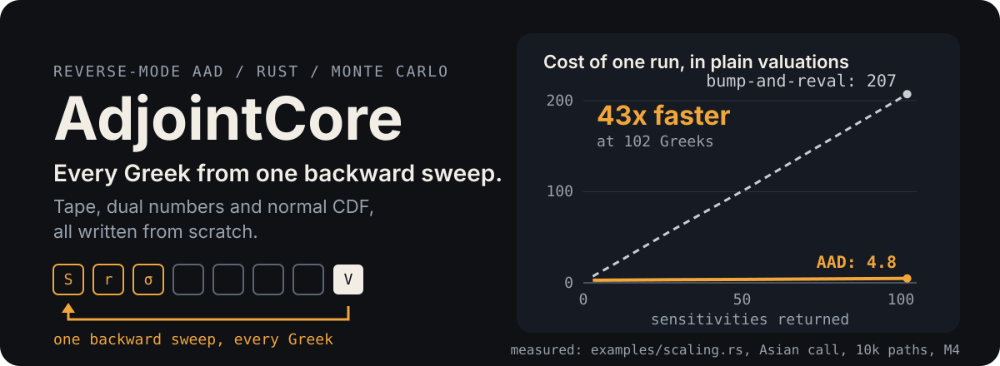

<p align="center">
  
</p>

AdjointCore prices options by Monte Carlo and gets all of their Greeks from
one backward pass over each simulated path. That is reverse-mode adjoint
algorithmic differentiation (AAD), written from scratch in Rust: the tape,
the dual numbers, every operator, and the normal CDF. No autodiff crate.

**Jump to:** [Results](#results-at-a-glance) ·
[How it works](#how-it-works) · [Getting started](#getting-started) ·
[Usage](#usage) · [Full results](#full-results) ·
[Limits](#where-it-stops-working) · [Tests](#running-the-tests)

## The 30-second version

- **The usual way to get Greeks is to bump each input and reprice.** For 100
  vol buckets that means 205 full Monte Carlo runs.
- **AAD records each path once and sweeps it backward once.** Every
  sensitivity falls out of that one sweep, so 102 Greeks cost about what 3
  do.
- **Both methods are in this repo**, on the same paths, so every speedup
  below is checked against the slow way and they agree.

## Results at a glance

Everything here was measured on an Apple M4, with the command shown. The
full tables are under [Full results](#full-results).

| What | Result | Command |
|---|---|---|
| 102 Greeks of an Asian option | **43x faster** than bump-and-reval (73.6 ms vs 3151.1 ms) | `cargo run --release --example scaling` |
| CVA of 10 netting sets, 620 sensitivities | **65x faster** (1.17 s vs 75.9 s) | `cargo run --release --example cva_scaling` |
| Do the two methods agree? | Yes, every gap is within **0.03 standard errors** | both of the above |
| 10 threads | **7.07x** speedup, bit-identical results at any thread count | `cargo run --release --example parallel` |
| Control variate on an Asian | price variance cut **186x to 808x** | `cargo run --release --example variance_reduction` |
| Pathwise Greeks of a barrier, unsmoothed | **wrong sign**: Delta +0.247 against a true -0.008, fixed by smoothing | `cargo run --release --example smoothing` |
| Test suite | **83 tests**, green on Linux CI | `cargo test --release` |

## About

AdjointCore is a portfolio project for quant pricing and risk work. It is
small enough to read in an afternoon and complete enough to measure.

It prices:

- **Vanilla options:** European calls and puts.
- **Path-dependent options:** arithmetic-average Asian calls.
- **Discontinuous payoffs:** digital calls and discretely monitored
  up-and-out calls, both smoothed so their Greeks make sense.
- **Counterparty risk:** unilateral CVA of netting sets of European options.

Each price comes back with Delta, Rho, and one vega per bucket of a
piecewise-constant vol curve. For CVA it also returns each counterparty's
hazard-rate sensitivity. Every Monte Carlo number comes with its own
standard error.

## How it works

1. **Record.** Spot, rate, and every bucket vol go on a tape. Simulating a
   path appends one node per operation, each storing the local derivative of
   that one step.
2. **Sweep.** One backward pass from the discounted payoff multiplies those
   local derivatives together. When it reaches the inputs, each input's
   adjoint is its Greek.
3. **Reset.** The tape is cleared for the next path but keeps the memory it
   grew, so later paths reuse it.
4. **Check.** Bump-and-reval runs on exactly the same paths, from the same
   seed, as an independent check.

One caveat matters for the maths: the pathwise derivative is only unbiased
when the payoff is continuous in the path. More on that in
[Where it stops working](#where-it-stops-working).

## Getting started

### Prerequisites

- Rust stable (built and tested with rustc 1.97.1)
- Python 3.9 or newer, plus `maturin`, only if you want the Python bindings

### Build and test

```bash
git clone https://github.com/savsuth/AdjointCore.git
cd AdjointCore
cargo test --release
```

That runs all 83 tests. It took 36.5 s on the M4.

### Run a benchmark

```bash
cargo run --release --example scaling
```

The others are `parallel`, `variance_reduction`, `smoothing`, and
`cva_scaling`. Heads up: `smoothing` takes about a minute and `cva_scaling`
about 33 minutes.

### Python

```bash
python3 -m venv .venv
source .venv/bin/activate
pip install maturin
maturin develop --release
python main.py
```

`main.py` prices Hull's textbook call (S = 42, K = 40, r = 10%, vol = 20%,
T = 0.5). The Python side is narrower than the Rust side; see
[Limits](#where-it-stops-working).

## Usage

The crate isn't on crates.io, so depend on it from git:

```toml
[dependencies]
adjoint-core = { git = "https://github.com/savsuth/AdjointCore" }
rand = "0.8"
```

Price an Asian call on a five-bucket vol curve and get every Greek in one go:

```rust
use adjoint_core::{AsianCall, monte_carlo_greeks_bucketed};
use rand::SeedableRng;
use rand::rngs::StdRng;

fn main() {
    // 12 monthly fixings, strike 100, on a one-year vol curve with five buckets.
    let asian = AsianCall { strike: 100.0, fixings: 12 };
    let vols = [0.18, 0.22, 0.20, 0.25, 0.15];

    let mut rng = StdRng::seed_from_u64(42);
    let r = monte_carlo_greeks_bucketed(&asian, 100.0, 0.05, &vols, 1.0, 100_000, &mut rng);

    println!("price {:.4} (SE {:.4})", r.greeks.price, r.std_error.price);
    println!("delta {:.4}  rho {:.4}", r.greeks.delta, r.greeks.rho);
    println!("vegas {:.3?}", r.greeks.vegas);
}
```

It prints:

```text
price 6.1918 (SE 0.0271)
delta 0.5951  rho 26.8641
vegas [9.748, 7.568, 3.582, 1.859, 0.241]
```

Other entry points:

- `monte_carlo_greeks_parallel` for many threads.
- `monte_carlo_greeks_reduced` for antithetic sampling and the control
  variate.
- `monte_carlo_cva` for netting-set CVA.
- `bump_and_reval` and `bump_and_reval_cva` for the slow way.

## Full results

Each section has the command, the setup, the full table, and what to take
from it. Click to open.

<details>
<summary><b>AAD against bump-and-reval as the Greek count grows</b> (43x at 102 Greeks)</summary>

```bash
cargo run --release --example scaling
```

**Setup**
- Arithmetic Asian call: 100 fixings, T = 1, S = K = 100, r = 5%.
- A flat 20% vol split into N buckets.
- 10,000 paths, seed 42, single thread.
- Every N divides 100, so the grid is the same 100 steps throughout, and one
  valuation costs the same at every N.
- Each N gets one warm-up round, then seven timed rounds; the table shows the
  median and [min, max].
- Measured 2026-10-23 on an Apple M4 (10 cores, 16 GB), macOS (Darwin
  24.1.0), rustc 1.97.1.

| N | sensitivities | valuation ms | AAD ms | bump ms | AAD / bump | AAD / valuation | bump / valuation | tape nodes / path | max gap (SE) |
|---|---|---|---|---|---|---|---|---|---|
| 1 | 3 | 13.8 | 39.2 [39.1, 39.3] | 97.4 [96.9, 102.0] | 0.403 | 2.83 | 7.0 | 512 | 0.027 |
| 2 | 4 | 13.9 | 39.7 [39.6, 42.1] | 128.2 [125.5, 144.1] | 0.310 | 2.85 | 9.2 | 518 | 0.027 |
| 5 | 7 | 14.1 | 40.9 [40.8, 41.3] | 212.4 [211.0, 213.5] | 0.193 | 2.91 | 15.1 | 536 | 0.027 |
| 10 | 12 | 14.5 | 43.0 [42.8, 45.3] | 361.4 [358.4, 372.7] | 0.119 | 2.97 | 25.0 | 566 | 0.027 |
| 25 | 27 | 14.3 | 48.1 [47.9, 49.5] | 801.4 [793.2, 880.1] | 0.060 | 3.36 | 55.9 | 656 | 0.027 |
| 50 | 52 | 15.0 | 56.0 [55.9, 57.4] | 1563.2 [1556.2, 1583.6] | 0.036 | 3.75 | 104.5 | 806 | 0.027 |
| 100 | 102 | 15.2 | 73.6 [73.6, 75.9] | 3151.1 [3142.9, 3193.1] | 0.023 | 4.84 | 207.1 | 1106 | 0.027 |

**What to take from it**
- **Bump-and-reval grows just as predicted.** It needs 2N + 5 valuations.
  Measured, that is 7.0 at N = 1 and 207.1 at N = 100, against 7 and 205.
- **AAD grows a little, not a lot.** Going from 3 to 102 Greeks took it from
  2.83 to 4.84 valuations' worth of time.
- **The growth is the tape.** Each bucket adds exactly 6 nodes per path (512
  to 1106), plus one adjoint read per extra vega. There is no step in the
  timings that would suggest a cache cliff.
- **Tape memory, derived not measured:** about 35 KB per path at 1106 nodes.
- **Same answers.** The largest gap between any AAD Greek and its bump value
  is 0.027 of the AAD standard error, at every N.
- **Repeat runs.**
  - A second run gave 73.5 ms (AAD) and 3214.1 ms (bump) at N = 100.
  - An earlier run on a busier machine gave a bump median of 3625.1 ms, with
    a max of 5555.7 ms.
  - AAD stayed within about 1 ms across all three runs.

</details>

<details>
<summary><b>Parallel paths</b> (7.07x on 10 threads, same answer every time)</summary>

```bash
cargo run --release --example parallel
```

**Setup**
- The same Asian call on a 100-bucket curve (102 sensitivities).
- 100,000 paths in chunks of 1,000, seed 42.
- Each thread count gets its own rayon pool, one warm-up, and five timed
  runs.
- Measured 2026-10-23 on the M4, which has 4 performance and 6 efficiency
  cores.

| threads | AAD ms (median [min, max]) | speedup vs 1 thread | identical to 1 thread |
|---|---|---|---|
| 1 | 757.5 [755.5, 758.5] | 1.00 | true |
| 2 | 386.6 [384.7, 391.5] | 1.96 | true |
| 4 | 207.2 [196.4, 226.5] | 3.66 | true |
| 8 | 119.2 [118.3, 138.5] | 6.35 | true |
| 10 | 107.1 [100.3, 131.4] | 7.07 | true |

**What to take from it**
- **Chunking is free.** The serial pricer took 758.2 ms [757.9, 758.4].
- **Scaling is near-linear up to 4 threads.** After that the extra threads
  land on the slower efficiency cores, so 10 threads give 7.07x, not 10x.
- **Repeat run:** 1.97x, 3.73x, 6.35x, and 7.09x at 2, 4, 8, and 10 threads.
- **Bit-identical at any thread count.** Each chunk has its own random
  stream, keyed by the seed and the chunk index. Results are merged in chunk
  order, so the thread count never changes the answer.

</details>

<details>
<summary><b>Variance reduction</b> (control variate: 186x to 808x on the price)</summary>

```bash
cargo run --release --example variance_reduction
```

**Setup**
- 12-fixing arithmetic Asian call, S = 100, r = 5%, T = 1.
- 5-bucket vol curve: 18, 22, 20, 25, 15%. Three strikes.
- 100,000 simulated paths from seed 42 for every method (antithetic: 50,000
  pairs).

**How to read the table**
- **VR** is (plain SE / method SE)^2: how many times more plain paths you
  would need for the same error.
- The vegas column gives the smallest and largest VR across the five
  buckets.
- Time is the median of five runs.
- Efficiency is the price VR times (plain time / method time).

Measured 2026-10-24 on the M4.

| K | method | price | price SE | VR price | VR delta | VR rho | VR vegas [min, max] | ms | efficiency |
|---|---|---|---|---|---|---|---|---|---|
| 90 | plain | 12.9684 | 0.03484 | 1.0 | 1.0 | 1.0 | [1.0, 1.0] | 170.2 | 1.0 |
| 90 | antithetic | 12.9206 | 0.01282 | 7.4 | 2.2 | 0.9 | [2.5, 3.3] | 147.7 | 8.5 |
| 90 | control | 12.9202 | 0.00123 | 808.1 | 29.9 | 14.6 | [52.0, 203.4] | 181.7 | 756.9 |
| 90 | both | 12.9183 | 0.00116 | 909.9 | 29.4 | 15.1 | [47.1, 214.4] | 182.0 | 851.2 |
| 100 | plain | 6.1918 | 0.02708 | 1.0 | 1.0 | 1.0 | [1.0, 1.0] | 140.3 | 1.0 |
| 100 | antithetic | 6.1654 | 0.01879 | 2.1 | 6.9 | 3.6 | [1.2, 1.3] | 131.5 | 2.2 |
| 100 | control | 6.1644 | 0.00127 | 455.1 | 40.7 | 26.4 | [32.6, 84.2] | 194.9 | 327.6 |
| 100 | both | 6.1628 | 0.00106 | 658.2 | 39.9 | 27.3 | [34.0, 82.3] | 151.1 | 611.3 |
| 110 | plain | 2.3241 | 0.01723 | 1.0 | 1.0 | 1.0 | [1.0, 1.0] | 104.5 | 1.0 |
| 110 | antithetic | 2.3056 | 0.01559 | 1.2 | 1.6 | 1.6 | [1.0, 1.1] | 99.4 | 1.3 |
| 110 | control | 2.3057 | 0.00126 | 186.2 | 28.5 | 20.9 | [18.4, 56.8] | 124.3 | 156.5 |
| 110 | both | 2.3042 | 0.00114 | 228.3 | 28.3 | 21.3 | [18.6, 60.8] | 126.8 | 188.3 |

**What to take from it**
- **The control variate does nearly all the work.**
  - The control is the geometric-average Asian, with coefficient 1. It has a
    closed form, recorded on the tape, so its Greeks are exact too.
  - It cuts price variance 186x to 808x, Delta and Rho 15x to 41x, and the
    bucket vegas 18x to 203x.
  - It costs 7% to 39% more time, so per unit of compute it is worth 157x to
    757x on the price.
- **It works best in the money.** There both averages sit above the strike
  and move together. Out of the money, the kinks of the two averages fall in
  different places.
- **Antithetic sampling is weak here and can hurt.**
  - It gives 1.2x to 7.4x on the price.
  - On the K = 90 Rho it is slightly worse than plain (0.9). Mirroring the
    normals only helps something that moves roughly monotonically with them.
- **Using both mostly helps the price.** That is up to 1.45x on top of the
  control alone.
- **Correctness checks.**
  - All four methods agree within their combined standard errors.
  - With one fixing, the control is the European call itself, and the
    controlled estimator returns Black-Scholes with an SE below 1e-10.
- **Repeat run:** identical VR columns. Times moved by up to 32 ms; the worst
  was K = 100 control, 194.9 ms against 162.9 ms.

</details>

<details>
<summary><b>Smoothed digital and barrier</b> (why raw pathwise Greeks fail, and what smoothing costs)</summary>

```bash
cargo run --release --example smoothing
```

**What smoothing does**
- `DigitalCall` pays 1 if S_T > K. `UpAndOutCall` is a call that dies if the
  spot is at or above the barrier on any fixing date.
- Both replace each jump with a centered call spread of width h, a straight
  ramp from 0 to 1 across [-h/2, h/2]. With h = 0 you get the exact payoff.
- **Bias is O(h^2).** The ramp is symmetric, so the first-order error
  cancels. A one-sided spread would give O(h).
- **Variance is O(1/h).** Inside the band the slope is 1/h, so a pathwise
  Greek's SE grows like 1/sqrt(h).

**Setup**
- S = K = 100, r = 5%, flat 20% vol, T = 1, seed 42.
- Bias is the estimate minus the reference, and z is the bias over its SE.
- Every row reuses the same paths, so read each column for its trend.
- The whole example takes 57 s (measured 2026-10-24 on the M4).

**Digital call, 1,000,000 paths**

The reference is the exact Black-Scholes digital: price 0.53232, Delta
0.01876, Vega -0.6567, Rho 1.3439.
- The smoothed payoff has its own exact value, (C(K - h/2) - C(K + h/2)) / h.
  "Delta exact bias" is therefore pure smoothing bias, with no noise in it.
- Delta RMSE is sqrt(bias^2 + SE^2).
- The last column is the worst |MC - call spread| / SE across all four
  outputs.

| h | price bias (z) | Delta | Delta bias (z) | Delta SE | Delta exact bias | Delta RMSE | Vega bias (z) | Vega SE | Rho bias (z) | gap to spread (max abs z) |
|---|---|---|---|---|---|---|---|---|---|---|
| 0 | -0.00038 (-0.8) | 0.00000 | -0.01876 (-) | 0.00000 | -1.9e-2 | 0.01876 | +0.6567 (-) | 0.0000 | -1.8758 (-3972.0) | - |
| 0.5 | -0.00041 (-0.9) | 0.01868 | -0.00008 (-0.4) | 0.00019 | -4.9e-7 | 0.00019 | +0.0030 (+0.5) | 0.0066 | -0.0079 (-0.4) | 0.87 |
| 1 | -0.00042 (-0.9) | 0.01875 | -0.00002 (-0.1) | 0.00013 | -2.0e-6 | 0.00013 | +0.0007 (+0.2) | 0.0046 | -0.0012 (-0.1) | 0.90 |
| 2 | -0.00042 (-0.9) | 0.01881 | +0.00005 (+0.5) | 0.00009 | -7.9e-6 | 0.00009 | -0.0020 (-0.6) | 0.0033 | +0.0054 (+0.6) | 0.91 |
| 5 | -0.00034 (-0.7) | 0.01872 | -0.00004 (-0.7) | 0.00006 | -4.9e-5 | 0.00007 | +0.0019 (+0.9) | 0.0020 | -0.0036 (-0.6) | 0.85 |
| 10 | -0.00017 (-0.4) | 0.01859 | -0.00017 (-4.6) | 0.00004 | -2.0e-4 | 0.00020 | +0.0076 (+5.3) | 0.0014 | -0.0172 (-4.5) | 0.89 |
| 20 | +0.00042 (+1.0) | 0.01801 | -0.00075 (-32.4) | 0.00002 | -7.6e-4 | 0.00076 | +0.0345 (+31.1) | 0.0011 | -0.0754 (-31.6) | 1.35 |

At h = 0, over 1,000,000 paths, the pathwise Delta and Vega have mean 0
**and standard error 0**. That means they are zero on every single path. The
pathwise Rho is -T times the price on every path (-0.532, against a true
1.344), because only the discount factor depends on the rate.

**Up-and-out call, barrier 120, 12 monthly fixings, 1,000,000 paths**

Neither reference has a closed form here.
- **Price reference.** The unsmoothed Monte Carlo price on 20,000,000 paths
  (seed 7): 1.84857, SE 0.00092.
  - The smoothing bias is measured on those same paths, as the mean of
    (smoothed payoff - exact payoff), so its SE is that of the difference
    alone.
- **Greek reference.** Bump-and-reval of the unsmoothed payoff on common
  random numbers, over 128 independent seeds of 1,000,000 paths: Delta
  -0.00827 (SE 0.00131), Vega -14.890 (SE 0.100), Rho 1.989 (SE 0.118).
  - Each repricing sees the jump, so the reference is unbiased up to
    O(bump^2).
  - Its variance is of order 1/bump, which is why it needs 128 million
    paths.
  - The z values combine both SEs.

| h | price smoothing bias (z) | Delta | Delta bias (z) | Delta SE | Vega | Vega bias (z) | Vega SE | Rho | Rho bias (z) | Rho SE |
|---|---|---|---|---|---|---|---|---|---|---|
| 0 | 0 (exact) | 0.2473 | +0.2555 (+184.7) | 0.0004 | 1.094 | +15.984 (+158.2) | 0.013 | 22.878 | +20.889 (+168.0) | 0.041 |
| 0.5 | -0.00044 (-5.2) | -0.0097 | -0.0014 (-0.4) | 0.0031 | -14.967 | -0.077 (-0.4) | 0.190 | 1.868 | -0.121 (-0.4) | 0.274 |
| 1 | -0.00171 (-14.5) | -0.0117 | -0.0035 (-1.4) | 0.0022 | -15.063 | -0.173 (-1.0) | 0.134 | 1.658 | -0.331 (-1.5) | 0.196 |
| 2 | -0.00716 (-43.1) | -0.0109 | -0.0027 (-1.3) | 0.0016 | -14.950 | -0.060 (-0.4) | 0.093 | 1.771 | -0.219 (-1.2) | 0.139 |
| 5 | -0.04398 (-167.5) | -0.0128 | -0.0045 (-2.7) | 0.0010 | -14.547 | +0.343 (+3.0) | 0.056 | 1.641 | -0.348 (-2.4) | 0.089 |
| 10 | -0.16565 (-441.2) | -0.0153 | -0.0070 (-4.7) | 0.0007 | -13.140 | +1.751 (+16.5) | 0.035 | 1.556 | -0.433 (-3.3) | 0.063 |

**What to take from it**
- **Unsmoothed pathwise Greeks are wrong, not just noisy.**
  - On the barrier, Delta comes out +0.247 against a true -0.008, Vega +1.09
    against -14.89, and Rho 22.9 against 2.0. Each is more than 150 SE off.
  - The pathwise estimate only sees the call on surviving paths. It misses
    the value lost at the knock-out, and that dominates.
- **The bias really is h^2.**
  - Digital Delta bias goes 4.9e-7, 2.0e-6, 7.9e-6, 4.9e-5, 2.0e-4, 7.6e-4
    for h = 0.5 to 20. That is about 4x per doubling, and 6.2 from h = 2 to 5
    against 6.25.
  - Barrier price bias goes -0.00044, -0.00171, -0.00716, -0.0440, -0.1657
    for h = 0.5 to 10: factors of 3.9, 4.2, 6.1 (against 6.25), and 3.8.
- **SE really is 1/sqrt(h).** Barrier Delta SE is 0.0031 at h = 0.5 and
  0.0007 at h = 10. That ratio is 4.4, against sqrt(20) = 4.47.
- **The best h depends on your path count.**
  - At 1,000,000 paths, digital Delta RMSE is lowest at h = 5 (0.00007).
  - It is 0.00019 at h = 0.5, where noise wins, and 0.00076 at h = 20, where
    bias wins.
  - More paths push the best h down.
- **What's left is pure smoothing bias.**
  - Every smoothed digital row is within 1.35 SE of its exact call-spread
    value.
  - For the barrier, the Greek bias is too small to resolve up to h = 2 (|z|
    at most 1.5).
  - It shows clearly at h = 5 and 10: Vega +0.34 (z 3.0) and +1.75 (z 16.5),
    and Delta -0.0070 (z -4.7) at h = 10.
- **The barrier Delta is nearly zero.** The gain from a higher spot and the
  loss from a likelier knock-out almost cancel (true Delta -0.008 +- 0.0013).
  Vega is the clearer Greek to judge the bias by.
- **The digital price bias is shared noise.** It sits around -0.0004 in every
  row because every row uses the same 1,000,000 paths.
- **Repeat run:** identical output.

</details>

<details>
<summary><b>Netting-set CVA</b> (65x at 620 sensitivities)</summary>

```bash
cargo run --release --example cva_scaling
```

**The two methods**
- **AAD** (`monte_carlo_cva`) records each path once and sweeps it once per
  netting set.
- **Bump-and-reval** (`bump_and_reval_cva`) reprices the whole book
  2(N + K) + 5 times, every time on the same paths.

**Setup**
- **Market:** S = 100, r = 5%, a flat 20% vol in N buckets over 5 years, 20
  quarterly exposure dates.
- **Book:** each netting set holds 10 European options: calls and puts,
  strikes 80 to 120, maturities 1 to 5 years, long and short. Each set has
  its own hazard rate between 1% and 3%, and recovery 40%. A bigger book only
  adds sets.
- **Runs:** 2,000 paths, seed 42, one warm-up, five timed rounds; median and
  [min, max].
- The last column is the worst gap, in AAD standard errors, over every set's
  sensitivities. Each set's sensitivity to another set's hazard rate must be
  exactly zero in both methods.
- Measured 2026-10-26 on the M4.

Why 2,000 paths rather than 10,000: one valuation of the 10-set book takes
3.1 s at 10,000 paths, so bump-and-reval at N = 50 would take about 6.5
minutes per run. Both methods are linear in the path count, so the ratios
hold. A 10,000-path check of the 10-set, 10-bucket book gave AAD /
valuation 1.77, against 1.83 here.

**Vol buckets N, with K = 10 netting sets:**

| N | sens. per set x sets | valuations | valuation ms | AAD ms (median [min, max]) | bump ms (median [min, max]) | AAD / bump | AAD / valuation | bump / valuation | total CVA | max gap (SE) |
|---|---|---|---|---|---|---|---|---|---|---|
| 1 | 13 x 10 | 27 | 635 | 1141 [1101, 1196] | 17301 [16924, 17679] | 0.066 | 1.80 | 27.3 | 18.8988 | 0.007 |
| 5 | 17 x 10 | 35 | 639 | 1154 [1148, 1227] | 23404 [22726, 23464] | 0.049 | 1.80 | 36.6 | 18.8988 | 0.007 |
| 10 | 22 x 10 | 45 | 640 | 1152 [1146, 1162] | 28847 [28782, 29079] | 0.040 | 1.80 | 45.1 | 18.8988 | 0.007 |
| 25 | 37 x 10 | 75 | 620 | 1157 [1153, 1163] | 46432 [46069, 46580] | 0.025 | 1.87 | 74.9 | 18.8167 | 0.008 |
| 50 | 62 x 10 | 125 | 603 | 1170 [1163, 1195] | 75947 [75247, 77324] | 0.015 | 1.94 | 125.9 | 18.4905 | 0.008 |

**Netting sets K, with N = 10 vol buckets:**

| K | sens. per set x sets | valuations | valuation ms | AAD ms (median [min, max]) | bump ms (median [min, max]) | AAD / bump | AAD / valuation | bump / valuation | total CVA | max gap (SE) |
|---|---|---|---|---|---|---|---|---|---|---|
| 1 | 13 x 1 | 27 | 67 | 111 [109, 111] | 1782 [1772, 1786] | 0.062 | 1.66 | 26.7 | 1.2923 | 0.000 |
| 2 | 14 x 2 | 29 | 124 | 208 [207, 210] | 3614 [3574, 3719] | 0.058 | 1.68 | 29.2 | 1.9786 | 0.002 |
| 5 | 17 x 5 | 35 | 304 | 538 [534, 547] | 10756 [10664, 10775] | 0.050 | 1.77 | 35.3 | 6.8629 | 0.007 |
| 10 | 22 x 10 | 45 | 613 | 1122 [1113, 1137] | 28012 [27760, 29318] | 0.040 | 1.83 | 45.7 | 18.8988 | 0.007 |
| 20 | 32 x 20 | 65 | 1208 | 2427 [2408, 2449] | 79230 [78778, 80411] | 0.031 | 2.01 | 65.6 | 38.2908 | 0.009 |

**What to take from it**
- **More vol buckets barely move AAD.**
  - Going from 130 to 620 sensitivities took AAD from 1141 to 1170 ms (1.80
    to 1.94 valuations).
  - Bump-and-reval went from 17.3 s to 75.9 s, which is 27.3 to 125.9
    valuations, against the 27 to 125 it should need.
  - At N = 50 that is 65x.
- **More netting sets cost both methods, just not equally.**
  - A valuation is linear in K, about 60 ms per set.
  - Bump-and-reval needs 2(N + K) + 5 of them, so it goes quadratic: 1.8 s
    at K = 1, 79.2 s at K = 20.
  - AAD also has a quadratic term, from one sweep per set over a tape that
    grows with K. It is small here: 1.66 to 2.01 valuations from K = 1 to
    20.
  - I expected both to grow roughly as K^2 before measuring. For AAD at this
    size, that was wrong.
  - My explanation, not separately measured: a sweep is two multiply-adds
    per node, while the forward pass pays for two normal CDFs per trade per
    date.
- **Path simulation is a rounding error.**
  - At N = 25 and 50 the grid has 40 and 60 steps instead of 20, yet a
    valuation got slightly faster (620 and 603 ms against 640). The cost is
    the Black-Scholes future values.
  - Those rows also show a different total CVA, because a finer grid draws
    different normals.
- **Same answers.** Every gap is within 0.009 SE, and the cross-set hazard
  sensitivities are exactly zero in both methods.
- **Run conditions.**
  - The whole run took 33 minutes, so it was not repeated.
  - The five timed rounds of any point spread by at most 8.6% (AAD at N = 1,
    [1101, 1196] ms).
  - For about 14 s during N = 50, a second copy of the benchmark ran by
    mistake before it was stopped. Those bump rounds stayed within 2.8%
    ([75247, 77324] ms).

</details>

<details>
<summary><b>Python call latency</b></summary>

```bash
python benchmark.py
```

Prints per-call latency (one `mc_pricer` call over all paths) and per-path
latency (that divided by the path count). No numbers from it are recorded in
this README.

</details>

## Where it stops working

- **Pathwise Greeks need a continuous payoff.**
  - Calls, puts, and arithmetic Asians are fine.
  - Digitals and barriers jump. A small bump never moves a path across the
    jump, so the raw pathwise Greek is a confident, wrong number.
  - Here they are only offered smoothed, with the bias measured above. The
    likelihood-ratio method would be unbiased; this engine does not offer
    it.
- **CVA is deliberately simple.**
  - It is unilateral, on European calls and puts only.
  - Each counterparty has a flat hazard rate, independent of the spot, so
    there is no wrong-way risk.
  - There is no collateral, DVA, or FVA.
- **One underlying, plain GBM.**
  - Vol is piecewise constant in time. There is no Heston, no local vol, and
    no multi-asset.
  - Each step is the exact log-normal transition (log-Euler, which is exact
    for GBM), so there is no discretization bias.
- **Python is the narrow part.**
  - The bindings cover only the European call, flat (`mc_pricer`) and
    bucketed (`mc_pricer_buckets`).
  - They run serially and return no standard errors.

## Running the tests

```bash
cargo test --release
```

83 tests: one unit test and 82 integration tests across twelve files. Every
Monte Carlo check uses a tolerance of five standard errors of the estimator
under test, never a fixed number.

The highlights:

- **Closed forms.** Price and Greeks match Black-Scholes for calls, puts,
  digitals, and a long-only CVA set.
- **Same paths, same answers.** AAD matches bump-and-reval on common random
  numbers for the Asian, the bucketed vol curve, the smoothed barrier, and
  mixed CVA books.
- **Bit-identical where it should be.** The parallel pricer on 1, 2, 4, and 8
  threads, one bucket against the flat pricer, and the tape-free CVA against
  the adjoint CVA.
- **Failure modes are pinned down.** The exact digital's pathwise Delta is
  zero on every path. Using a stale tape handle panics instead of reading
  garbage.

<details>
<summary>Everything the suite checks</summary>

- **Tape and operators.** Accumulation and reset; every operator and math
  function against its analytical derivative.
- **Normal CDF.** Checked against independently generated reference values.
- **Handle validity.** A stale `Dual` or `Gradient` after a reset, a second
  sweep, or on another thread is rejected.
- **European call.** Matches closed-form Black-Scholes, with a cross-seed
  consistency check.
- **Put.**
  - Matches Black-Scholes.
  - Put-call parity holds on common paths, with exact standard errors for
    the difference.
- **Asian.** Every Greek matches bump-and-reval on common random numbers.
- **Vol curve.**
  - One bucket reproduces the flat pricer bit for bit.
  - With equal bucket vols, the vegas sum to the flat Vega exactly on common
    paths.
  - On an unequal curve, the price and Greeks match Black-Scholes at the
    integrated-variance vol, and each bucket vega matches bump-and-reval.
  - An Asian whose fixings fall between bucket edges agrees with the flat
    Asian.
- **Bump-and-reval.** Matches the adjoint Greeks on the same seed, and its
  price equals the adjoint price exactly.
- **Parallel.**
  - 1, 2, 4, and 8 threads give bit-identical results (20,500 paths, so the
    last chunk is partial).
  - Two chunk sizes give consistent estimates.
  - The merged accumulator equals one sequential pass, including with an
    empty side.
- **Variance reduction.**
  - All four methods agree.
  - With one fixing the controlled estimator is Black-Scholes, with an SE
    below 1e-10.
- **Smoothing.**
  - The digital closed form equals minus the strike derivative of the call.
  - The smoothed digital matches its call spread at three strikes and two
    widths.
  - The bias falls 4x when h halves.
  - The exact digital's pathwise Delta and Vega are zero on every path.
  - An unreachable barrier is the European call bit for bit.
  - The smoothed barrier's Greeks match bump-and-reval of the same payoff.
- **CVA.**
  - Netting never raises CVA or exposure, and a fully offset set has CVA and
    every sensitivity exactly zero.
  - A long-only set matches its closed form for CVA, every Greek, the
    hazard-rate sensitivity, and the exposure profile.
  - Equal bucket vegas sum to the flat Vega.
  - Cross-set hazard sensitivities are exactly zero, and the total equals the
    sum of the sets.
  - The tape-free CVA equals the adjoint CVA bit for bit.
  - Mixed books match bump-and-reval.

</details>

CI (`.github/workflows/ci.yml`) runs `cargo test --release` and a maturin
build-install-import check on every push and pull request, on
`ubuntu-latest`. There is no deploy step.

## Project layout

| Path | What's in it |
|---|---|
| `src/tape.rs` | The tape: a thread-local log of operations and the backward sweep |
| `src/dual.rs` | `Dual`, a 16-byte handle to a tape node, and `Gradient` |
| `src/ops.rs` | Operators and math functions, each with its derivative |
| `src/special.rs` | Normal CDF and density |
| `src/payoff.rs` | The `Payoff` and `Real` traits and every payoff |
| `src/pricer.rs` | The Monte Carlo pricer, vol buckets, parallel chunks, Black-Scholes closed forms |
| `src/variance.rs` | Antithetic sampling and the geometric control variate |
| `src/bump.rs` | Bump-and-reval, the slow way and the oracle |
| `src/xva.rs` | Netting-set CVA |
| `src/python.rs` | The PyO3 bindings |
| `examples/` | The five benchmarks above |
| `tests/` | The test suite |
| `main.py`, `benchmark.py` | Python smoke test and latency script |

<details>
<summary><b>Engine internals</b>, for the curious</summary>

- **Tape.**
  - Each node stores up to two parent indices and their local partial
    derivatives.
  - It lives in a `bumpalo` arena, one per thread.
  - A reset clears the node list but keeps its capacity.
- **Dual numbers.**
  - A `Dual` is `{ value, index, generation }`. It holds no derivative data
    itself.
  - Every recording gets a fresh generation id, so using a handle from an
    old recording panics with a "stale" message instead of reading whatever
    node now sits at that index.
  - The generation is a `u32`, so it wraps after 2^32 resets.
- **One payoff code path.**
  - Payoffs are written once against a small `Real` trait implemented for
    `Dual` and for `f64`.
  - On `Dual` every step is recorded; on `f64` nothing is.
  - That gives a tape-free pricer that sees exactly the same paths, which is
    what makes bump-and-reval a fair oracle.
- **Normal CDF.**
  - The common Hart/West rational approximation is off by about 8.7e-9 near
    |x| = 8, measured against 60-digit references.
  - This one splits at |x| = 1.5. Below that it uses an all-positive `erf`
    series; above it, a Mills-ratio continued fraction run to convergence.
  - Worst case is 2.6e-15 against the same references.
- **Vol curve grid.**
  - Fixing dates and bucket edges are merged in exact integer units of
    T / (nN).
  - So every step sits inside one bucket and stays an exact log-normal
    transition.
- **Parallel merge.**
  - Each chunk keeps Welford accumulators.
  - They are combined with the Chan, Golub, and LeVeque pairwise formula, in
    chunk order.
- **Control variate.**
  - The geometric Asian's closed form is written in `Dual` arithmetic and
    recorded once per run, so its Greeks are exact.
  - The coefficient is fixed at 1, which keeps every Greek unbiased; an
    estimated one would add O(1/n) bias.
- **CVA.**
  - Each trade's value at an exposure date is Black-Scholes on the variance
    left on the curve.
  - Spot, rate, every bucket vol, and every hazard rate are tape inputs.
  - Each path is recorded once and swept once per netting set.

</details>

## Built using

- [Rust](https://www.rust-lang.org/), with [rand](https://crates.io/crates/rand)
  and [rand_distr](https://crates.io/crates/rand_distr) for random numbers
- [bumpalo](https://crates.io/crates/bumpalo) for the tape arena
- [rayon](https://crates.io/crates/rayon) for parallel paths
- [PyO3](https://pyo3.rs/) and [maturin](https://www.maturin.rs/) for the
  Python bindings

## Author

- [@savsuth](https://github.com/savsuth)

## Acknowledgements

The methods this leans on:

- **Hull**, *Options, Futures, and Other Derivatives*, for the textbook check
  values.
- **Kemna and Vorst**, for the geometric Asian control variate.
- **Chan, Golub, and LeVeque**, for merging variance accumulators.
- **Cody**, for the split-exponent trick in the normal density.
- **Lentz**, for the continued-fraction evaluation.
